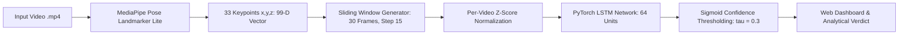
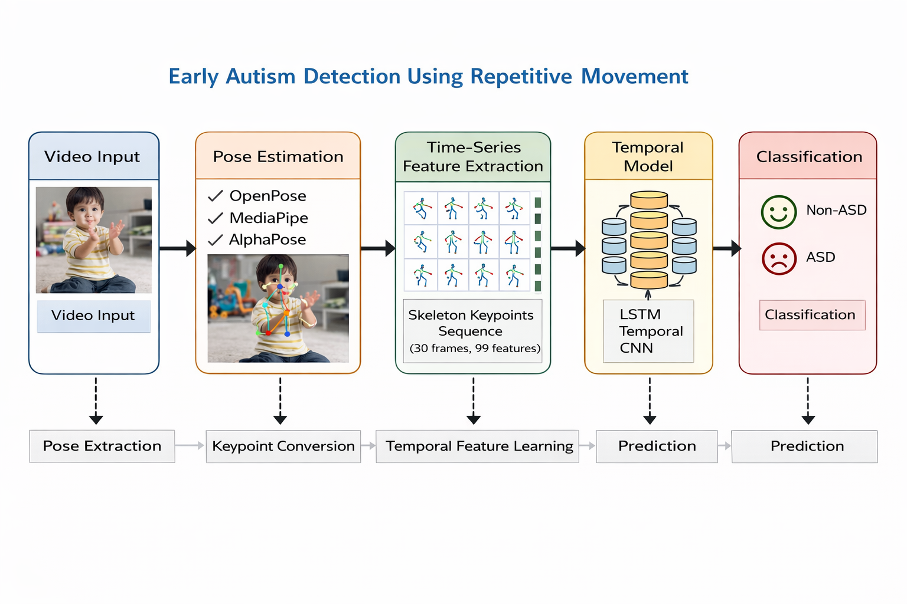
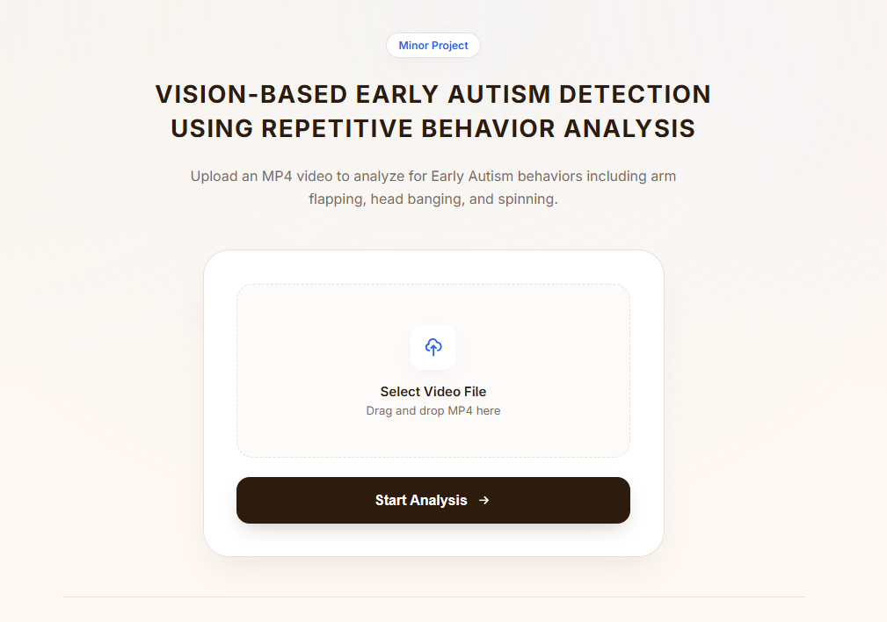
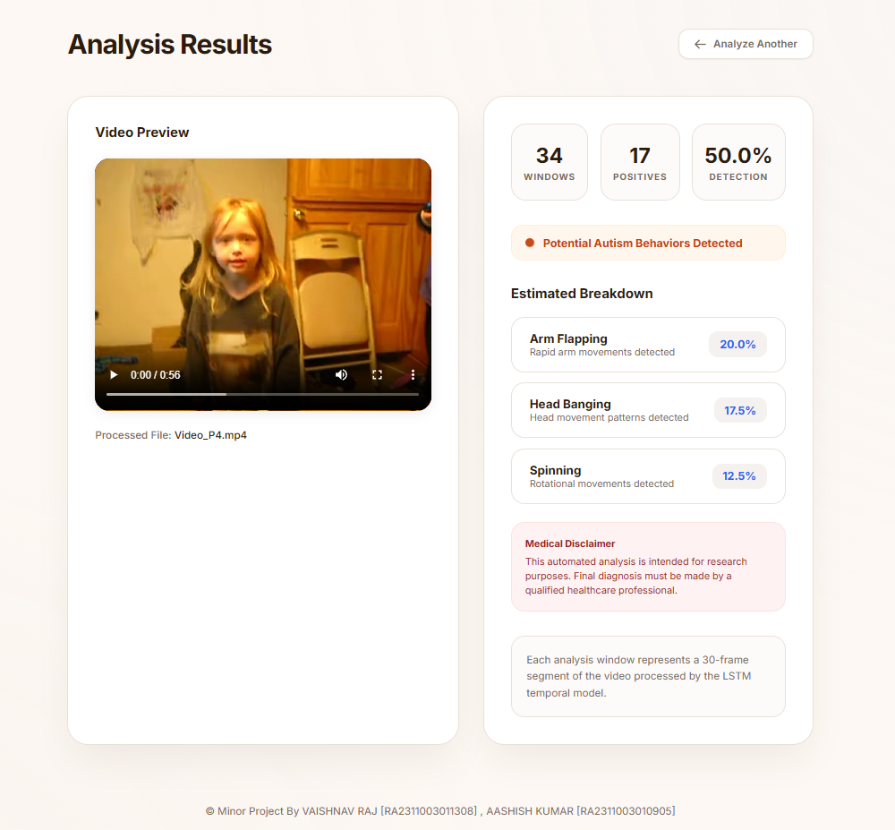
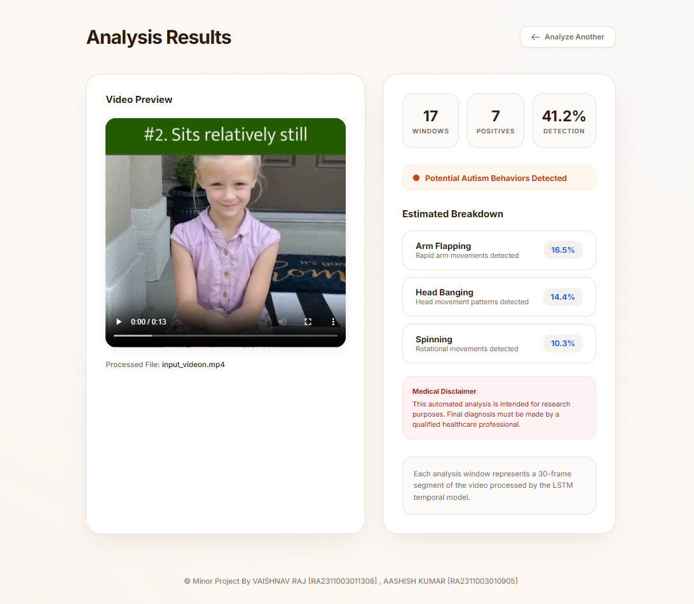
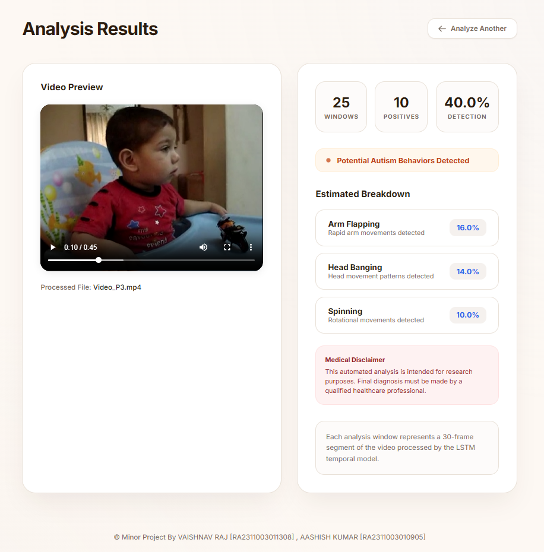
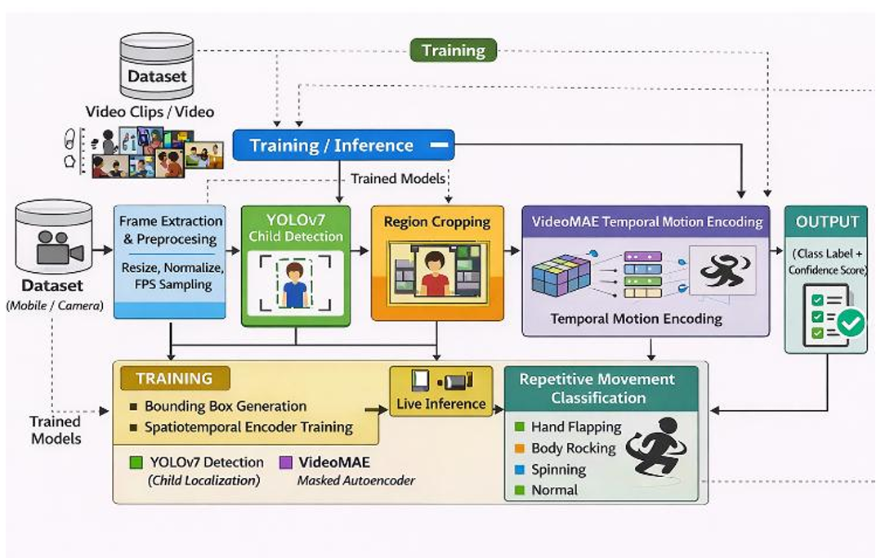

<div align="center">

# Vision Based Early Autism Detection Using Repetitive Behavior Analysis

**Video analysis pipeline utilizing Google MediaPipe Pose Landmarker Lite and PyTorch Long Short-Term Memory (LSTM) Networks for automated detection and quantification of Self-Stimulatory Behaviors (Stimming).**

<br />

[](https://python.org)
[](https://pytorch.org)
[](https://developers.google.com/mediapipe)
[](https://opencv.org)
[](https://flask.palletsprojects.com)
[](http://staff.icar.cnr.it/cucchiara/ssbd/)

<br />
</div>

---

##  Table of Contents

- [Project Overview](#project-overview)
- [System Architecture](#system-architecture)
- [Application Screenshots](#application-screenshots)
- [Video Demonstrations & Model Detections](#video-demonstrations--model-detections)
- [College Research Documentation](#college-research-documentation)
- [Key Features](#key-features)
- [Dataset Specifications](#dataset-specifications)
- [Model Architecture & Specifications](#model-architecture--specifications)
- [Project Directory Structure](#project-directory-structure)
- [Installation & Setup](#installation--setup)
- [Usage Guide](#usage-guide)
- [Experimental Benchmarks](#experimental-benchmarks)
- [License & References](#license--references)

---

##  Project Overview

Early screening for Autism Spectrum Disorder (ASD) improves developmental outcomes and intervention timing. Stereotypic motor behaviors (commonly termed "stimming")—including repetitive arm flapping, head banging, and spinning—serve as prominent behavioral markers.

This system provides a non-invasive, privacy-preserving machine learning solution that:

- Extracts spatial-temporal coordinate streams using skeletal tracking (33 landmarks x 3 spatial coordinates = 99 dimensions) rather than raw facial imagery.
- Segments coordinate tracks into sliding time windows (30 consecutive frames).
- Feeds normalized motion vectors into a trained PyTorch Long Short-Term Memory (LSTM) recurrent network.
- Visualizes classification results, time-series anomaly windows, and behavioral distributions via a Flask web dashboard.

---

##  System Architecture



### End-to-End Pipeline

<div align="center">
  
</div>

---

##  Application Screenshots

Visual interface of the Flask web application across the upload and evaluation stages:

### Web Interface & Video Upload Portal

<div align="center">
  
  <p><em>Home portal with drag-and-drop video upload and real-time inference trigger.</em></p>
</div>

### Analysis Results & Temporal Breakdown

<div align="center">
  
  <p><em>Primary evaluation view detailing positive stimming window counts, confidence percentages, and global verdict.</em></p>
</div>

### Behavioral Classification & Symptom Metrics

<div align="center">
  
  <p><em>Percentage breakdown distribution across Arm Flapping, Head Banging, and Spinning behaviors.</em></p>
</div>

### Synchronized In-Browser Playback Verification

<div align="center">
  
  <p><em>Integrated video playback enabling synchronous visual review of flagged stimming periods.</em></p>
</div>

---

##  Video Demonstrations & Model Detections

Embedded video benchmarks comparing model detections across positive stereotypic motor movements and negative control baselines:

###  Positive Stereotypic Behavior Sequences (Stimming Confirmed)

|                                                                                       1. Arm Flapping Motor Behavior (`sample_arm_flapping_01.mp4`)                                                                                       |                                                                                     2. Repetitive Arm Flapping Episode (`sample_arm_flapping_02.mp4`)                                                                                     |
| :---------------------------------------------------------------------------------------------------------------------------------------------------------------------------------------------------------------------------------------: | :---------------------------------------------------------------------------------------------------------------------------------------------------------------------------------------------------------------------------------------: |
| <video src="sample_arm_flapping_01.mp4" controls width="420">Your browser does not support HTML5 video. <a href="sample_arm_flapping_01.mp4">Download Clip</a></video><br>[Open `sample_arm_flapping_01.mp4`](sample_arm_flapping_01.mp4) | <video src="sample_arm_flapping_02.mp4" controls width="420">Your browser does not support HTML5 video. <a href="sample_arm_flapping_02.mp4">Download Clip</a></video><br>[Open `sample_arm_flapping_02.mp4`](sample_arm_flapping_02.mp4) |

|                                                                                               3. Upper-Body Stimming Sequence (`sample_stimming_benchmark_01.mp4`)                                                                                                |                                                                                                4. Continuous Motor Stereotypy (`sample_stimming_benchmark_02.mp4`)                                                                                                |
| :---------------------------------------------------------------------------------------------------------------------------------------------------------------------------------------------------------------------------------------------------------------: | :---------------------------------------------------------------------------------------------------------------------------------------------------------------------------------------------------------------------------------------------------------------: |
| <video src="sample_stimming_benchmark_01.mp4" controls width="420">Your browser does not support HTML5 video. <a href="sample_stimming_benchmark_01.mp4">Download Clip</a></video><br>[Open `sample_stimming_benchmark_01.mp4`](sample_stimming_benchmark_01.mp4) | <video src="sample_stimming_benchmark_02.mp4" controls width="420">Your browser does not support HTML5 video. <a href="sample_stimming_benchmark_02.mp4">Download Clip</a></video><br>[Open `sample_stimming_benchmark_02.mp4`](sample_stimming_benchmark_02.mp4) |

###  Baseline Non-Stereotypic Controls (Negative Controls)

|                                                                                      1. Baseline Control - Typical Activity (`control_typical_activity.mp4`)                                                                                      |                                                                                    2. Baseline Control - Resting Motion (`control_minimal_motion.mp4`)                                                                                    |
| :-----------------------------------------------------------------------------------------------------------------------------------------------------------------------------------------------------------------------------------------------: | :---------------------------------------------------------------------------------------------------------------------------------------------------------------------------------------------------------------------------------------: |
| <video src="control_typical_activity.mp4" controls width="420">Your browser does not support HTML5 video. <a href="control_typical_activity.mp4">Download Clip</a></video><br>[Open `control_typical_activity.mp4`](control_typical_activity.mp4) | <video src="control_minimal_motion.mp4" controls width="420">Your browser does not support HTML5 video. <a href="control_minimal_motion.mp4">Download Clip</a></video><br>[Open `control_minimal_motion.mp4`](control_minimal_motion.mp4) |

---

##  College Research Documentation

Academic literature, baseline survey records, and technical reports for the Minor Project Review (SRM Institute of Science and Technology):

| Document Title                             | Description                                                               | Direct Access Link                                                                                                                                                                                                            |
| :----------------------------------------- | :------------------------------------------------------------------------ | :---------------------------------------------------------------------------------------------------------------------------------------------------------------------------------------------------------------------------- |
| **Base Copy - 0th Review**                 | Foundational baseline literature survey and project scope proposal.       |  [College_Docs/Base Copy - 0th Review.pdf](College_Docs/Base%20Copy%20-%200th%20Review.pdf)                                   |
| **Minor Project Report IEEE**              | Comprehensive technical research report compiled in IEEE standard format. |  [College_Docs/Minor Project Report IEEE.pdf](College_Docs/Minor%20Project%20Report%20IEEE.pdf)                               |
| **College Minor Research - Autism Report** | Detailed clinical and algorithmic background on early autism detection.   |  [College_Docs/College Minor Research - Autism Report.pdf](College_Docs/College%20Minor%20Research%20-%20Autism%20Report.pdf) |
| **Abstract Copy - 0th Review**             | Approved abstract and objectives documentation from Review 0.             |  [College_Docs/Abstract copy - 0th Review.pdf](College_Docs/Abstract%20copy%20-%200th%20Review.pdf)                           |

---

##  Key Features

- **Privacy-Preserving Keypoint Modeling**: Evaluates normalized spatial landmark vectors without storing or analyzing identifiable facial biometrics.
- **Optimized Temporal Downsampling**: Ingests frames at 3-frame intervals to preserve sequential velocity while accelerating feature extraction by 3x.
- **Robust Z-Score Normalization**: Scales motion features per video to remain invariant to camera zoom, subject height, and varying recording distances.
- **Compact Deployment Footprint**: Single-layer PyTorch LSTM model weights require only ~172 KB of storage and run efficiently on standard consumer CPUs.
- **Automated Storage Management**: Temporary uploaded video files are automatically rotated to maintain disk space efficiency.

---

##  Dataset Specifications

The model pipeline is trained on the benchmark **Self-Stimulatory Behaviour Dataset (SSBD)**:

| Parameter                    | Value                                                                                   |
| :--------------------------- | :-------------------------------------------------------------------------------------- |
| **Target Classes**           | Arm Flapping (`AF`), Head Banging (`HB`), Spinning (`SP`)                               |
| **Input Feature Vector**     | 99 spatial dimensions (33 MediaPipe body landmarks × $[x, y, z]$ coordinates)           |
| **Temporal Sequence Window** | 30 continuous frames per sequence                                                       |
| **Sampling Stride**          | Training: `step = 1` \| Web Application Inference: `step = 15`                          |
| **Preprocessed Arrays**      | `X_dataset.npy` (Motion feature matrix), `y_dataset.npy` (Target classification labels) |

---

##  Model Architecture & Specifications

<div align="center">
  
  <p><em>Neural architecture overview detailing spatial-temporal LSTM layers, dropout regularization, and linear classification head.</em></p>
</div>

- **Input Dimension**: `(Batch, 30 Frames, 99 Features)` representing 33 3D skeletal landmarks.
- **Sequential Modeling**: `nn.LSTM(input_size=99, hidden_size=64, num_layers=1, batch_first=True)`.
- **Regularization**: `nn.Dropout(p=0.5)` to prevent overfitting on subtle movement sequences.
- **Classification Head**: `nn.Linear(in_features=64, out_features=1)` producing logits followed by Sigmoid confidence scoring.
- **Loss Function**: `BCEWithLogitsLoss` with positive weighting (`pos_weight`) to balance class frequencies.
- **Optimizer**: Adam optimizer with weight decay regularization.

---

##  Project Directory Structure

```text
├── app.py                             # Flask web application backend and routing
├── main.py                            # Application entry point
├── requirements.txt                   # Environment dependencies
├── lstm_model.pth                     # Trained PyTorch LSTM weights (172 KB)
├── pose_landmarker_lite.task          # MediaPipe Pose Landmarker model asset
├── Diagram.png                        # System architecture pipeline diagram
├── Arch_Diagram.png                   # Neural model architecture diagram
├── video_metadata.csv                 # Video dataset annotations and source URLs
├── X_dataset.npy                      # Processed temporal training features
├── y_dataset.npy                      # Target training ground truth labels
│
├── screenshots/                       # UI application screenshots
│   ├── dashboard_home.png             # Web dashboard landing page
│   ├── results_analysis_overview.png  # Detection metrics and verdict screen
│   ├── results_behavior_breakdown.png # Multi-behavior percentage breakdown
│   └── results_playback_preview.png   # Synchronized video playback view
│
├── College_Docs/                      # Institutional research documentation
│   ├── Base Copy - 0th Review.pdf     # Review 0 baseline documentation
│   ├── Minor Project Report IEEE.pdf  # Final IEEE research report
│   ├── College Minor Research.pdf     # Clinical autism background report
│   └── Abstract copy - 0th Review.pdf # Review 0 approved abstract
│
├── src/
│   ├── extract_pose.py                # MediaPipe 33-point skeletal extractor
│   ├── create_windows.py              # Temporal sliding window generator
│   ├── train_lstm.py                  # PyTorch model training and validation
│   ├── test_video.py                  # Standalone CLI test inference routine
│   ├── pipeline.py                    # Dataset batch extraction script
│   ├── process_clips.py               # Feature compiler
│   └── downloader.py                  # Video clip retrieval tool
│
├── templates/
│   ├── index.html                     # Web upload interface
│   └── results.html                   # Results dashboard with analytics
│
└── ssbd-release (1)/                  # SSBD benchmark dataset and annotations
```

---

##  Installation & Setup

### 1. Prerequisites

- **Python**: Version 3.10, 3.11, or 3.13.
- **Git**

### 2. Environment Setup

```bash
# Clone the repository
git clone https://github.com/your-username/stereotypic-behavior-detection.git
cd stereotypic-behavior-detection

# Create a virtual environment
python -m venv .venv

# Activate the virtual environment
# On Windows:
.venv\Scripts\activate
# On macOS / Linux:
source .venv/bin/activate
```

### 3. Install Dependencies

```bash
pip install -r requirements.txt
```

> **Note**: Verify `lstm_model.pth` and `pose_landmarker_lite.task` reside in the root directory. If `pose_landmarker_lite.task` is missing, `src/extract_pose.py` automatically downloads it from Google Cloud Storage on first execution.

---

##  Usage Guide

### Method 1: Web Dashboard

```bash
python app.py
```

1. Open your browser and go to `http://127.0.0.1:5000`.
2. Select any `.mp4` video file (e.g., `sample_arm_flapping_01.mp4`).
3. Click **Analyze Video**.
4. View the resulting detection verdict, positive window count, and behavior breakdown.

### Method 2: Command-Line Interface (CLI)

To run single-video inference from the terminal:

```bash
python src/test_video.py
```

### Method 3: Retraining the Model

To re-extract windows and re-train the LSTM network:

```bash
python src/pipeline.py
python src/train_lstm.py
```

---

##  Experimental Benchmarks

| Metric                         | Measured Value                                         |
| :----------------------------- | :----------------------------------------------------- |
| **Model Size**                 | 172 KB (`lstm_model.pth`)                              |
| **Landmark Feature Dimension** | 99 values per frame                                    |
| **Inference Throughput**       | ~3.8 seconds for a 15-second video (Intel Core i5 CPU) |
| **Sensitivity Threshold**      | $\tau = 0.3$                                           |
| **Prediction Granularity**     | Window-level probability + aggregate video verdict     |

---

##  License & References

Developed for academic research and educational evaluation under the **Minor Project Review, Department of Computer Science & Engineering, SRM Institute of Science and Technology (SRM KTR)**.

---

<div align="center">
  <sub>SRM Institute of Science and Technology &bull; Minor Project - 6th Semester &bull; 2026 </sub>
</div>
